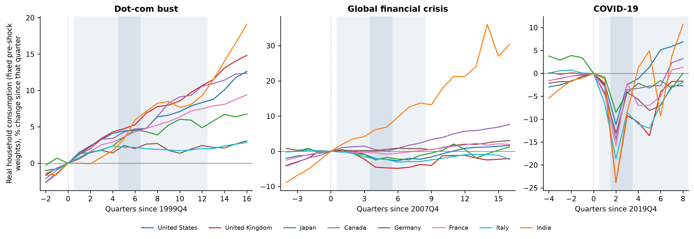
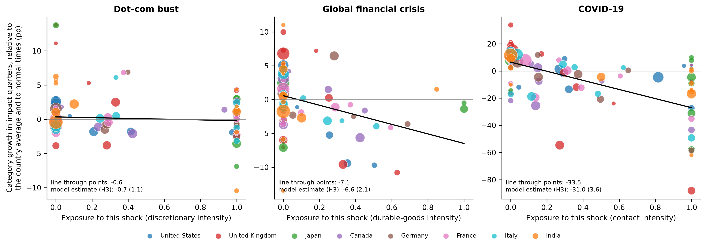
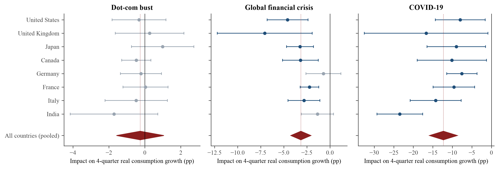

# Consumption Reallocation and Macroeconomic Resilience After Major Economic Shocks

This repository holds the data, code and results behind the paper

> Bannerjee, S., Srivastava, A. and Seth, J. S. (2026). *Consumption Reallocation and Macroeconomic Resilience After Major Economic Shocks: Evidence from Eight Economies, 1999–2021.*

Every table, figure and number in the paper can be rebuilt from this repository with one command, and a second command checks that the rebuilt numbers match the published ones exactly.

## The study in brief

Recessions change what households buy, not only how much they spend. We ask whether the way spending is reshuffled depends on the kind of shock, and whether economies with very different institutions respond in the same way.

We use quarterly household consumption in the twelve COICOP divisions (food, housing, transport, restaurants and hotels, and so on) for the seven G7 economies and India, and study three shocks: the dot-com bust (2001), the global financial crisis (2008–09) and COVID-19 (2020). Five hypotheses are tested:

| | Hypothesis | Expected sign |
|---|---|---|
| H1 | Total consumption falls in the shock's impact quarters | negative |
| H2 | Necessities (food, housing and utilities, health) gain budget share | positive |
| H3 | The categories most exposed to that particular shock fall the most | negative |
| H4 | Spending stays below its pre-shock growth path afterwards | negative |
| H5 | Economies with stronger pre-shock fundamentals are hit less | positive |

H1–H4 are estimated twice: for all eight countries together (the pooled analysis, on the common timeline 1999Q2–2021Q4) and for each country on its own, both on the common timeline and on its full national record. H5 compares countries, so it exists only in the pooled analysis. Every result receives one of four verdicts fixed before estimation: **supported**, **opposite sign**, **no effect** or **undecided**. The verdicts combine cluster-robust tests, placebo tests that re-run the model on normal periods, and equivalence tests that can show an effect is too small to matter. All samples end in 2021Q4, before the 2022 energy-price shock.



*Real household consumption in the eight countries around each shock, per cent change since the quarter before the shock window (Figure 1 of the paper).*

## Running it

You need Python 3.12 or newer and about 1 GB of free disk space. No internet connection is needed once the packages are installed, because every raw download is already stored in the repository.

On macOS or Linux:

```bash
git clone https://github.com/JSseth5405/consumption-reallocation.git
cd consumption-reallocation
python3 -m venv .venv
source .venv/bin/activate
python -m pip install -r requirements.txt
python run_all.py
python verify.py --all
```

On Windows, use `py -3.12 -m venv .venv` and `.venv\Scripts\activate` for the two environment lines; the other commands are the same.

What the commands do:

* **`python run_all.py`** rebuilds everything from the country data: the resilience index, all models, every result table, the data files, the diagnostics, all ten paper figures and the long results document. It takes roughly 15 to 45 minutes, depending on the computer.
* **`python verify.py --all`** runs the whole analysis again from scratch and compares every result file with the published copy. It ends with `VERIFICATION PASSED - every published number reproduces exactly.` It takes about as long as `run_all.py`.
* **`python verify.py`** (without `--all`) runs only the quick checks: package versions, input fingerprints, data shape, and the numerical identities behind the fast estimation routines. It finishes in about a minute.
* **`python run_all.py --panels`** additionally rebuilds the France, Italy and Canada category panels from their raw statistical-office files before running the analysis.

The versions in `requirements.txt` are the ones the published results were produced with; `verify.py` reports any installed version that differs from them.

If the repository sits in a folder that syncs to iCloud, OneDrive or Dropbox, move it to a folder that does not sync before running. Syncing services sometimes remove local copies of newly written files while the analysis is running.

## Where each figure and table in the paper comes from

All result tables are plain CSV files. In the files, the paper's specifications, timelines and verdicts have short names, explained in the next section.

| In the paper | File in this repository | Made by |
|---|---|---|
| Figure 1, consumption around each shock | `results/figures/fig1_consumption_paths.png` (and `.pdf`) | `code/analysis/figures_paper.py` |
| Figure 2, reallocation in the raw data | `results/figures/fig2_reallocation_h3.png` | `code/analysis/figures_paper.py` |
| Figure 3, spending against its normal-growth path | `results/figures/fig3_recovery_gaps_h4.png` | `code/analysis/figures_paper.py` |
| Figure 4, country and pooled impact estimates | `results/figures/fig4_country_vs_pooled_h1.png` | `code/analysis/figures_paper_extra.py` |
| Figure 5, resilience and impact | `results/figures/fig_h5_resilience_vs_impact.png` | `code/analysis/figures_paper_extra.py` |
| Figure 6, placebo tests for the pooled results | `results/diagnostics/diag_placebo_distributions.png` | `code/analysis/diagnostics.py` |
| Figure B1, necessity share and exposure | `results/figures/figA_exposure_shares.png` | `code/analysis/figures_paper_extra.py` |
| Figure B2, composition of spending | `results/diagnostics/diag_spending_shares.png` | `code/analysis/diagnostics.py` |
| Figure B3, timelines of the study | `results/diagnostics/diag_timelines.png` | `code/analysis/diagnostics.py` |
| Figure E1, placebo against clustered p-values | `results/figures/figA_placebo_vs_clustered.png` | `code/analysis/figures_paper_extra.py` |
| Tables 6 and C1, pooled results | `results/tables/pooled_results.csv` | `code/analysis/models_all_countries.py` |
| Tables 7 and C2, country results | `results/tables/individual_results.csv` | `code/analysis/models_individual_countries.py` |
| Table 8, pooled and country results compared | `results/tables/individual_results.csv` together with `results/tables/pooled_results.csv` | `code/analysis/models_individual_countries.py`, `code/analysis/models_all_countries.py` |
| Table 9 and D2, results by specification | `results/tables/individual_counts_by_spec.csv`, `results/tables/individual_combined_counts_by_spec.csv` | `code/analysis/tables_individual_countries.py` |
| Table 10 and E1, placebo evidence | columns `p_randomisation`, `n_placebo` of the two results files above | `code/analysis/placebo_tests.py` |
| Table C3, three shocks together by country | `results/tables/individual_results_combined.csv` | `code/analysis/models_individual_countries.py` |
| Table C4, resilience components | `results/tables/h5_by_component.csv` | `code/analysis/models_all_countries.py` |
| Table D3, verdicts changed by the country events | `results/tables/individual_core_vs_clean_changes.csv` | `code/analysis/tables_individual_countries.py` |
| Table E2, H4 placebo rule | `results/diagnostics/h4_placebo_rule_comparison.csv` | `code/analysis/diagnostics.py` |
| Table E3, reproducibility checks | `results/diagnostics/verification_report_full.txt` | `verify.py` |
| Table B2, resilience index | `data/resilience/resilience_index.csv` | `code/analysis/data_resilience_index.py` |
| Table D1, country events | `data/country_events.csv` | compiled by hand from the sources listed in the file |
| Section 7, further checks | `results/tables/robustness_quarterly_observed.csv`; rows `H2_volume` and `H4_local` of `pooled_results.csv` | `code/analysis/robustness_quarterly_vs_annual.py` |

The figures use Times New Roman when it is installed and DejaVu Serif otherwise, so on some systems they look slightly different from the paper. The numbers are unaffected.

## Reading the result files

The main files, `pooled_results.csv` and `individual_results.csv`, have one row per test. The short names used in them:

| Column | Value | Meaning in the paper |
|---|---|---|
| `spec` | `core` | without country effects |
| | `clean` | with country effects (the headline results) |
| | `mechanism` | with policy responses and the real oil price |
| | `extended` | with optional events |
| `timeline` | `matched` | the common timeline, 1999Q2–2021Q4 |
| | `full` | the country's full national record |
| `pool` | `dotcom`, `gfc`, `covid` | the dot-com bust, the financial crisis, COVID-19 |
| | `combined` | all three shocks together (average of the three shock effects) |
| | `combined_common` | one common coefficient for the three shocks (robustness only) |
| `decision_headline` | `supported` | supported |
| | `rejected_opposite_sign` | opposite sign |
| | `negligible_effect` | no effect |
| | `inconclusive` | undecided |
| | `not_estimable` | the test cannot be run for that sample |

Other useful columns: `estimate` and `std_error`; `p_parametric`, the one-sided p-value of the clustered test; `p_randomisation` and `n_placebo`, the placebo p-value and the number of placebo periods behind it; `tost_p` with `ci90_low`, `ci90_high` and `sesoi`, the equivalence test and its threshold; and, in the pooled file, `p_holm`, the Holm-adjusted p-value. Every column of the data files is defined in `data/data_dictionary.csv`.

## Main results

Pooled analysis, headline specification:

| | H1 | H2 | H3 | H4 | H5 |
|---|---|---|---|---|---|
| Dot-com bust | undecided | undecided | undecided | undecided | no effect |
| Financial crisis | **supported** | undecided | **supported** | **supported** | undecided |
| COVID-19 | **supported** | **supported** | **supported** | **supported** | undecided |
| All three shocks | **supported** | **supported** | **supported** | **supported** | undecided |

All eleven supported results remain significant after the Holm correction. COVID-19 lowered four-quarter real consumption growth by 12.28 percentage points in its impact quarters and the financial crisis by 3.15 points; three to four years after the financial crisis, spending was still 4.7 per cent below its pre-crisis growth path.

Country by country, the number of the fifteen country-timelines (eight on the common timeline, seven full records; India has only the common one) in which each hypothesis is supported:

| | H1 | H2 | H3 | H4 |
|---|---|---|---|---|
| Dot-com bust | 0 | 2 | 3 | 3 |
| Financial crisis | 12 | 6 | 10 | 12 |
| COVID-19 | 15 | 15 | 15 | 9 |
| All three together | 15 | 9 | 15 | 12 |



*Each point is one spending category in one country. The more exposed a category was to the shock, the more it fell, most of all during COVID-19 (Figure 2 of the paper).*



*Country estimates of the impact with 90 per cent intervals; the diamond is the pooled estimate (Figure 4 of the paper).*

A longer document produced by the code, `results/reports/Results_Individual_and_All_Countries.pdf`, goes through every country, every specification and every check, and ends with a log of the decisions taken during the study.

## Data

Every series comes from an official statistical source, and the raw files are stored in the repository so that the analysis runs offline.

| Country | Source | Categories published | Full record |
|---|---|---|---|
| United States | BEA, NIPA Tables 2.3–2.4 | quarterly | 1959Q1–2021Q4 |
| United Kingdom | ONS, Consumer Trends | quarterly | 1985Q1–2021Q4 |
| Japan | Cabinet Office (ESRI), SNA | quarterly | 1994Q1–2021Q4 |
| Canada | Statistics Canada, table 36-10-0124-01 | quarterly | 1981Q1–2021Q4 |
| Germany | Destatis, via Eurostat | annually | 1995Q1–2021Q4 |
| France | INSEE, via Eurostat | annually | 1980Q1–2021Q4 |
| Italy | ISTAT, via Eurostat | annually | 1996Q1–2021Q4 |
| India | MoSPI, National Accounts Statistics | annually | 1999Q2–2021Q4 |

**Countries that publish categories once a year.** For Germany, France, Italy and India each category's official annual value is spread across the four quarters in proportion to an official quarterly indicator (proportional Denton–Cholette benchmarking). Germany, France and Italy use household consumption by durability group; India uses total quarterly consumption. The four quarters always add up to the published annual figure, and the statistical tests treat each year (for India, each April–March financial year) as one unit of information. The code for this step is in `code/country_builders/`.

**Resilience index (H5).** Four components measured in the year before each shock: general government gross debt (IMF World Economic Outlook) and household credit relative to GDP (Bank for International Settlements), both read through FRED, and consumer-price inflation and unemployment (World Bank, World Development Indicators). The raw files are in `data/resilience/raw/`.

**Oil price.** WTI spot price and US CPI from FRED, in `data/oil_price/raw/`, used only in the specification with policy responses and the oil price.

**Country events.** `data/country_events.csv` lists the 97 dated events (tax changes, strikes, natural disasters, second shocks, policy responses) controlled in the different specifications, each with its source.

**Countries left out.** Russia and China were considered and excluded; `documentation/russia_note.md` explains why for Russia, and `documentation/pre1999_events_rejected.csv` lists early events that were tested and not admitted.

The raw data remain the property of the statistical offices and institutions that publish them and are included here only so that the results can be reproduced. Please cite the original sources and follow their terms of use if you reuse the data.

## What is in the repository

```
README.md                     this file
requirements.txt              Python packages, with the versions used for the paper
run_all.py                    runs the whole analysis in order
verify.py                     checks the inputs and, with --all, re-runs and compares every number
code/
  analysis/                   the analysis, one file per step
  country_builders/           builds the France, Italy and Canada panels from raw files
countries/
  MANIFEST.csv                SHA-256 fingerprints of the eight country panels
  <Country>/
    <country>_analysis_data.csv   the country's data with every variable, full record
    data/final/                   the quarterly category panel used by the analysis
    data/raw/, data/interim/,     raw and intermediate files and build checks
    config/, metadata/            (France, Italy and Canada)
    reproduction_check/           Germany only: the panel rebuilt by the France/Italy code
data/
  all_countries_pooled_analysis_data.csv   the data of the pooled analysis
  data_dictionary.csv                      definitions of every column
  country_events.csv                       the 97 country events
  resilience/                              the resilience index and its raw sources
  oil_price/                               oil-price and CPI series
documentation/                notes on excluded countries and rejected events
results/
  tables/                     every result table
  figures/                    the paper figures, as PNG and PDF
  diagnostics/                data coverage, exposure, placebo distributions, verification report
  reports/                    the long results document
```

The analysis code in `code/analysis/`:

| File | What it does |
|---|---|
| `study_protocol.py` | countries, timelines, shocks, hypotheses and all fixed settings |
| `data_resilience_index.py` | builds the pre-shock resilience index |
| `data_oil_price.py` | real oil-price growth |
| `models_all_countries.py` | estimation functions and the pooled analysis (H1–H5) |
| `models_individual_countries.py` | the country-by-country analysis (H1–H4) |
| `inference_tests.py` | cluster-robust tests, equivalence tests and verdicts |
| `inference_cluster_bootstrap.py` | two-way clustering and the wild cluster bootstrap |
| `placebo_tests.py` | normal periods and the placebo test |
| `robustness_quarterly_vs_annual.py` | pooled results for the quarterly-publishing and the benchmarked countries separately |
| `tables_all_countries.py` | resilience components and the pooled summary |
| `tables_individual_countries.py` | country tables and the comparison with and without country effects |
| `data_export.py` | writes the eight country data files and the pooled data file |
| `diagnostics.py` | data coverage, exposure and placebo diagnostics, and Figures 6, B2 and B3 |
| `figures_paper.py` | Figures 1 to 3 |
| `figures_paper_extra.py` | Figures 4, 5, B1 and E1 |
| `report_results.py` | the long results document |

## Checks built into the repository

`verify.py --all` confirms, in order, that:

1. the installed package versions match `requirements.txt`;
2. the eight country panels match their SHA-256 fingerprints in `countries/MANIFEST.csv`;
3. the pooled panel has 8 countries, 12 categories and 91 quarters and its weights sum to one;
4. the France, Italy and Canada category panels add up to the published totals;
5. the fast wild cluster bootstrap agrees with a slower reference implementation;
6. the fast placebo estimates agree with full re-estimation;
7. the France and Italy build code, run on frozen German inputs, reproduces Germany's panel exactly;
8. a complete re-estimation reproduces all 28 published result and data files exactly.

The report of the last full run is in `results/diagnostics/verification_report_full.txt`.

## Questions

Please open an issue on this repository for questions about the code or the data.
